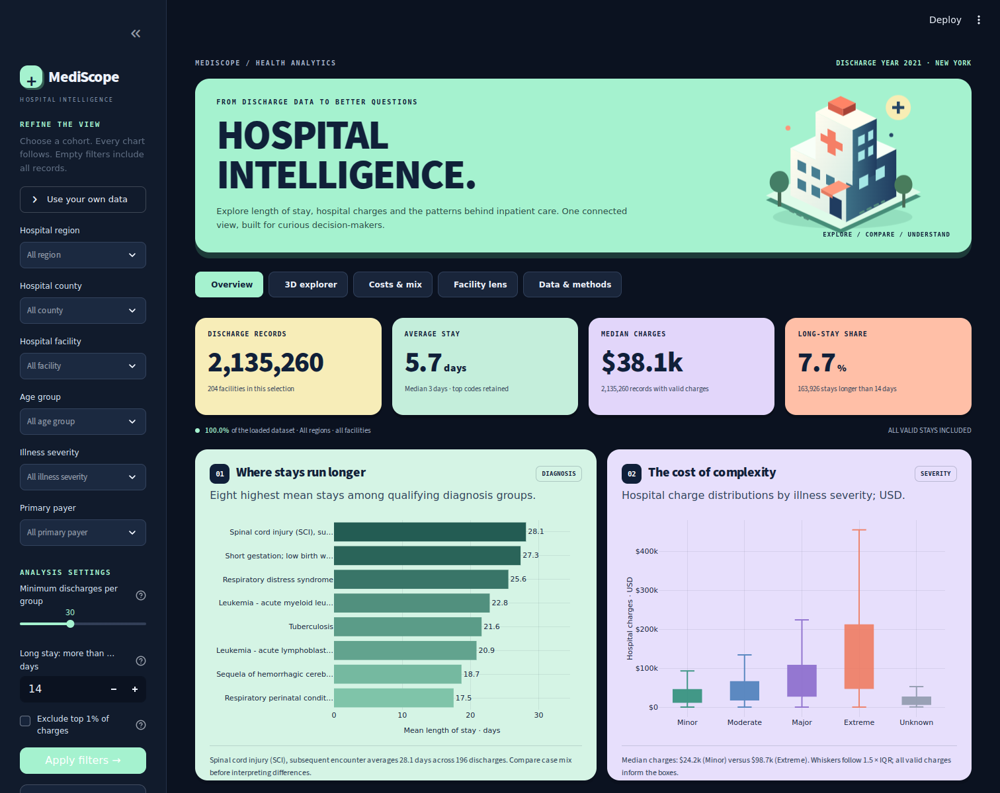
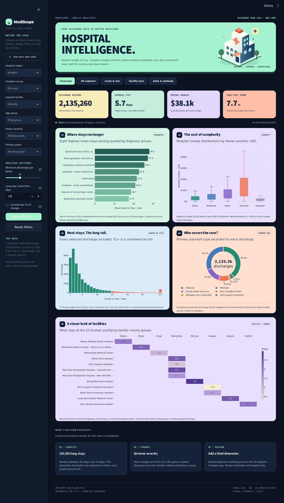
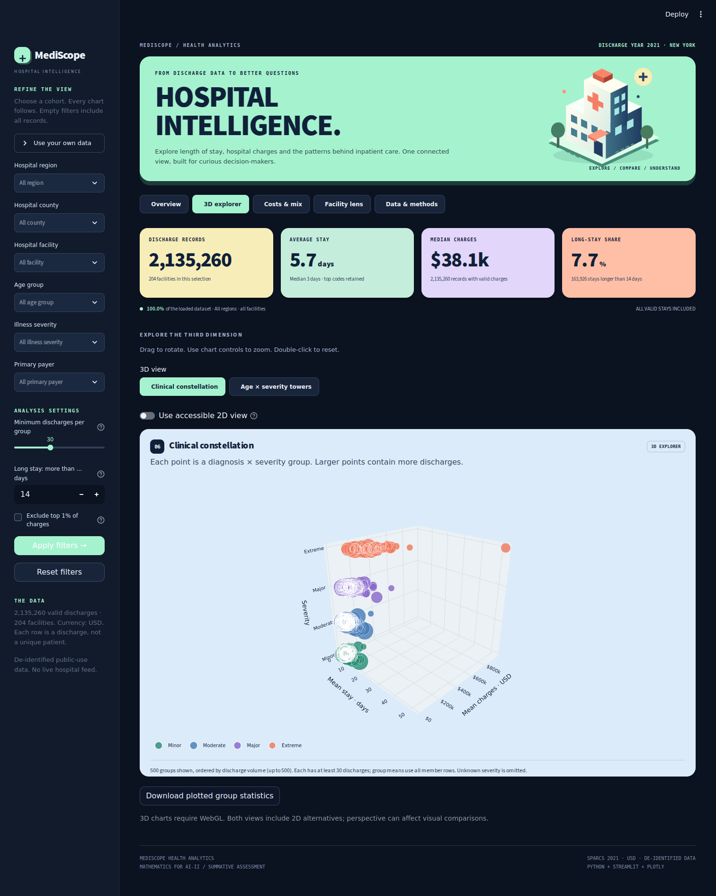
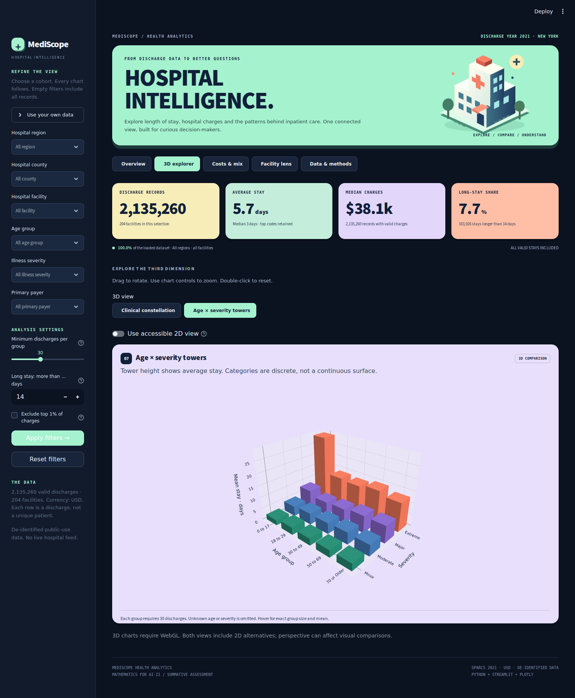
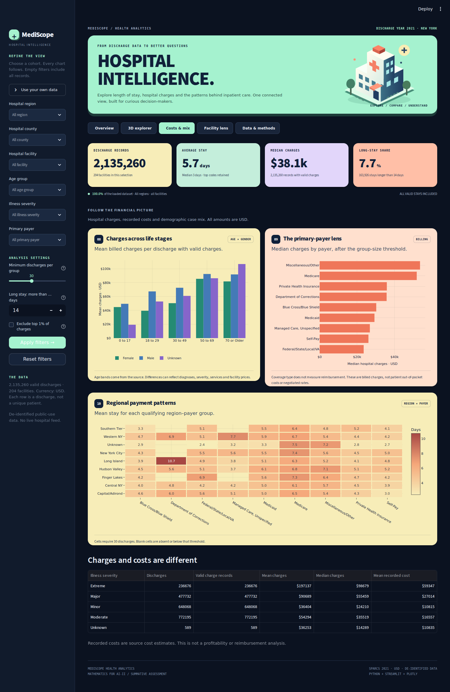
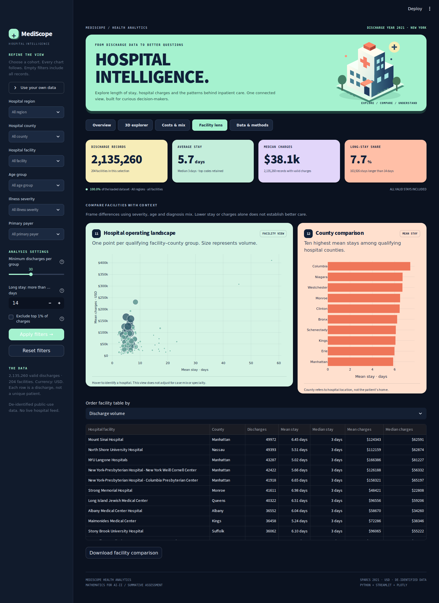
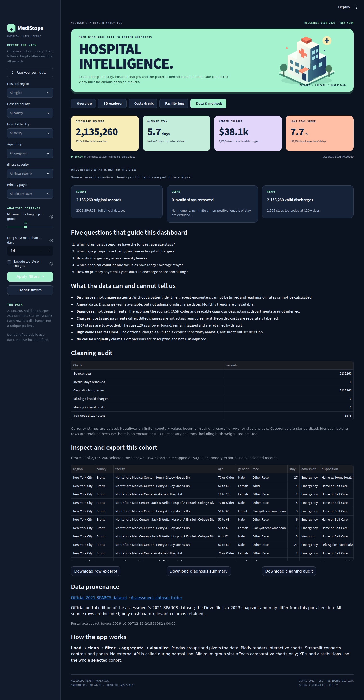
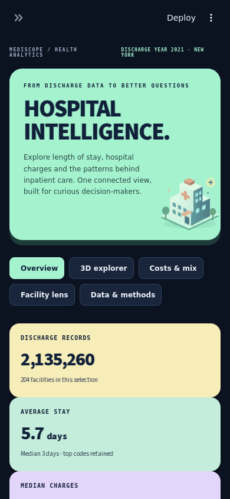

# MediScope · Hospital Intelligence

A vibrant, interactive hospital inpatient-discharge dashboard built with **Python, Streamlit, Pandas and Plotly** for Mathematics for AI-II, Scenario 2.

Explore **2,135,260 real discharge records across 204 New York hospital facilities**. Compare length of stay, diagnosis categories, illness severity, hospital charges, payment types and regional patterns in five connected workspaces.

<!-- LIVE_APP_START -->
**Live dashboard: deployment pending.** This package has been run and tested locally. A public Streamlit app URL has not been created yet. After deployment, replace this paragraph with your actual link, or run `python scripts/set_live_url.py https://YOUR-ACTUAL-APP.streamlit.app` and commit the updated README.
<!-- LIVE_APP_END -->



## What you can do

- Filter by hospital region, county, facility, age group, severity and primary payer.
- Apply all filters together; every page and metric uses the selected cohort.
- Rotate **two real 3D visualizations**: the clinical constellation and age–severity towers.
- Use 2D alternatives when WebGL is unavailable or a flat comparison is clearer.
- Inspect exact values and group sizes on hover; export charts as PNGs.
- Compare the full data with an explicitly labelled view excluding the top 1% of charges.
- Download diagnosis summaries, facility comparisons, the cleaning audit and a bounded row excerpt.
- Upload a compatible CSV, or run immediately with the complete included dataset.

No API key, database, paid service or dataset download is needed for the default app.

## Five connected workspaces

| Workspace | Purpose | Main views |
|---|---|---|
| **Overview** | Understand the selected cohort | Four KPIs; diagnosis bar chart; severity box plot; stay histogram; payer donut; facility–county heatmap |
| **3D explorer** | Compare more than two dimensions | Diagnosis × severity constellation; age × severity towers; matching 2D alternatives |
| **Costs & mix** | Explore charges and case mix | Age × gender charges; payer billing; region × payer pivot; charges versus recorded costs |
| **Facility lens** | Investigate hospital differences | Facility bubble plot; county ranking; sortable, downloadable facility summary |
| **Data & methods** | Make the analysis inspectable | Research questions; audit; source information; assumptions; data preview; exports |

### Actual app screenshots

These are captures of the running Streamlit application using the included full dataset, not design mockups. The 3D captures use a browser with WebGL enabled.

<details>
<summary>Full overview and all five required visualizations</summary>



</details>

**Clinical constellation** — each bubble represents a diagnosis–severity group; its size represents discharge volume.



**Age × severity towers** — each tower’s height is mean length of stay.



<details>
<summary>Costs, facilities, data methods and mobile layout</summary>






</details>

## Upload to GitHub and deploy

1. **Extract the ZIP.** Upload its contents to your repository; do not upload the ZIP as the app.
2. Put `app.py`, `analytics.py`, `charts.py`, `requirements.txt` and `README.md` at the repository root. Keep the `data/`, `assets/`, `screenshots/`, `scripts/`, `tests/` and `.streamlit/` folders intact. Include **all 22** `discharges_*.parquet` files.
3. Use the repository naming pattern requested by your school, for example `IADAI202-StudentID-StudentName`.
4. Visit [Streamlit Community Cloud](https://share.streamlit.io/), connect GitHub and choose **Create app**.
5. Choose your repository and branch. Set **Main file path** to `app.py` and Python to **3.12** in the advanced settings.
6. Deploy. The default app loads the included data without credentials or secrets.
7. Copy the actual public app URL into the **Live dashboard** section above. Also add it to the repository’s About/Website field.
8. Open the public app link and check that all pages work. Follow the assessment’s access/submission requirements for your GitHub repository.

**Folder upload matters:** `.streamlit/config.toml` supplies the matching native widget theme. On macOS, use Command–Shift–Period to show hidden folders when selecting files. Each data chunk is small enough for a normal GitHub web upload. Uploading only `app.py` and `requirements.txt` is insufficient for this project.

### Run locally

Python **3.12** is recommended.

```bash
python -m venv .venv
# macOS / Linux
source .venv/bin/activate
# Windows PowerShell instead: .venv\Scripts\Activate.ps1
python -m pip install -r requirements.txt
python -m streamlit run app.py
```

Open the local address printed by Streamlit, normally `http://localhost:8501`.

## Data source and provenance

The assessment links to **Hospital_Inpatient_Discharges__SPARCS_De-Identified___2021_20231012.csv**, an approximately 832 MB file in its [Scenario 2 Drive folder](https://drive.google.com/drive/folders/1bHdRvwN77O3F85pFzoqmzBY2wNOabXms).

This package contains a complete, compact extract of the **official Health Data NY edition of the same 2021 SPARCS dataset**, obtained from its [official dataset page](https://health.data.ny.gov/Health/Hospital-Inpatient-Discharges-SPARCS-De-Identified/tg3i-cinn) and [public API](https://health.data.ny.gov/resource/tg3i-cinn.csv). The portal edition can differ from the assessment’s October 2023 snapshot; it is not represented as a byte-identical copy of that file. The bundled provenance JSON records the retrieval timestamp, source row count and selected columns.

- **All 2,135,260 source rows are included before cleaning**, not an initial slice or synthetic sample.
- The included edition has 204 distinct named facilities.
- Only the fields needed for this dashboard are retained; ZIP codes, birth weight, certificate identifiers and unused procedure fields are omitted.
- Parquet compression and categorical columns make the full dataset practical for GitHub and Streamlit. The loaded analytical table uses approximately 94 MB; the running app and charts use additional memory.
- The bundle is static. Normal app startup does not refresh the source or call the API.

To use the **exact assessment CSV**, download it yourself and prepare the bundle locally:

```bash
python scripts/prepare_data.py --csv "/path/to/Hospital_Inpatient_Discharges__SPARCS_De-Identified___2021_20231012.csv"
```

To rebuild from the current official portal edition:

```bash
python scripts/prepare_data.py --official
```

These commands process 100,000-row chunks, validate the new bundle before replacing the old one, and regenerate the audit/provenance files. Re-upload the resulting `data/` folder and refresh the README’s dataset figures and screenshots if the source changes. Do not rename the original raw CSV to a Parquet extension.

## Research questions and assessment coverage

| Research question | Analysis / visualization |
|---|---|
| Which diagnosis categories have the longest stays? | CCSR code and description grouped with `groupby().agg()`; top-eight average-stay bar chart |
| Which age groups incur higher charges? | Mean charges by source age band and gender; grouped bar chart |
| How does illness severity relate to charges? | Exact quartiles and Tukey whiskers; box plot, plus separately labelled cost summary |
| Which counties and facilities have longer stays? | Facility–county `pivot_table()` heatmap, county bars, facility bubble plot and comparison table |
| How do payment types differ in billing and volume? | Primary-payer donut, median-charge comparison and region–payer pivot |

All five required visual types are on **Overview**: bar, box, heatmap, pie/donut and histogram. The extra pages add investigation tools without replacing the required visuals.

## How the app works

1. **Load:** read the bundled Parquet chunks and verify the row count against the audit. The default loaded data is cached as a shared read-only resource.
2. **Clean:** `analytics.clean_data()` parses stay/currency fields, standardizes categories and reports every excluded stay or invalid monetary field. This is done during bundle preparation, or immediately for an uploaded CSV.
3. **Filter:** selections within one field use OR; selections across fields use AND. Empty selections mean all. Press **Apply filters** to commit the sidebar form.
4. **Aggregate:** Pandas computes counts, means, medians, total charges and pivots from every row in the selected cohort.
5. **Render:** Plotly receives aggregated values, not millions of raw browser points. Streamlit renders the selected workspace.
6. **Export:** summary downloads include all qualifying groups. The on-screen row preview is limited to 500 and row CSV export to the first 50,000 records, both explicitly labelled.

### Mathematical definitions

- **Discharge count:** number of included discharge records.
- **Mean stay:** sum of numeric stay days divided by the discharge count. A `120+` stay contributes a lower-bound value of 120.
- **Median charges:** the 50th percentile of valid, nonnegative charges. Missing monetary values are excluded from monetary denominators.
- **Long-stay share:** `100 × count(stay > selected threshold) / selected discharge count`. Default threshold: 14 days; this is an adjustable analytical choice.
- **Box plots:** Q1, median and Q3 from all valid group charges. Whiskers are the most extreme observed values within `1.5 × IQR` of Q1/Q3. Individual outlier dots are omitted for performance; no default data trimming occurs.
- **Minimum group size:** default 30. Applies to diagnosis rankings, facility/county/region–payer comparisons and 3D groups, not cohort KPIs, age/gender charts or overall distributions.
- **Charge-tail sensitivity:** optionally excludes records above the loaded dataset’s fixed 99th-percentile charge threshold. Records with missing charges remain in stay analyses. Every KPI then reflects this smaller cohort.
- **Clinical constellation:** up to 500 largest diagnosis–severity groups meeting the threshold; exact group means use all group members. X = mean stay, Y = mean charges, Z = ordinal severity. Bubble size increases with discharge count and is visually capped.
- **3D towers:** mean stay for discrete age–severity groups; no interpolated surface or invented continuous age values.

### Cleaning decisions

| Field / issue | Handling |
|---|---|
| Non-numeric, non-finite or non-positive stay | Drop the row and count it in the audit |
| `120+` stay | Store 120 plus a `stay_topcoded` flag; retain by default |
| Currency symbols, commas, accounting negatives | Parse numerically; negative/non-finite amounts become missing |
| Missing charges or costs | Preserve the row for non-monetary analysis; show the valid-charge count |
| Categorical spacing, age spelling, severity and gender | Standardize readable labels; missing values become `Unknown` |
| Diagnosis meaning | Preserve the provided CCSR codes and descriptions; no guessed mapping |
| Identical-looking records | Preserve; there is no encounter identifier to establish duplication |
| Valid high values | Retain; optional, visible charge-tail sensitivity control |
| Unused / null-heavy fields | Omit from the distributed analytical bundle |

The bundled cleaning audit records **0 invalid stay rows removed**, **0 missing/invalid monetary values**, and **1,575 top-coded 120+ stays**. Keeping every row is the observed outcome, not an assumption that every future input will be clean.

## Limits that matter

- Records represent **discharges, not distinct patients**.
- There is no linkable patient ID or admission/discharge date. **Readmission rates and monthly trends cannot be calculated** from this public file.
- Clinical diagnosis groups are available; hospital departments are not inferred.
- Charges are billed amounts. Recorded costs are separate estimates. Neither is actual payment, patient out-of-pocket spending or profit.
- County is the hospital’s location, not the patient’s home county.
- Facility comparisons are not risk-adjusted and cannot establish care quality or causation.
- `120+` top-coding makes reported mean stays lower bounds where those observations occur.
- The original source is a **2021 cohort**. It is not current hospital activity.
- 3D perspective can distort comparison. Exact hover values and 2D alternatives remain available.

## Project structure

```text
app.py                    Streamlit screens, shared filters and exports
analytics.py              Cleaning, filtering and analytical calculations
charts.py                 Plotly 2D and 3D visualizations
requirements.txt          Pinned app dependencies
requirements-dev.txt      Optional testing / screenshot dependencies
.streamlit/config.toml    Theme and upload settings
assets/                   Local stylesheet and isometric hospital SVG
data/                     22 compact data chunks, source metadata and cleaning audit
screenshots/              Actual desktop, 3D and mobile app captures
scripts/prepare_data.py   Convert the assessment CSV or refresh official data
scripts/set_live_url.py   Insert your actual deployed URL in this README
scripts/capture_screenshots.py  Reproduce the app screenshots
tests/                    Data-logic and full-data Streamlit integration tests
```

## Verification and reproducibility

```bash
python -m pip install -r requirements-dev.txt
python -m pytest tests -q
```

The tests cover invalid stays and currency values, top-coding, correct monetary denominators, preserved duplicate-looking records, empty/cohort filters, safe CSV text, all five Streamlit workspaces and both 3D views. Screenshot generation also checks a real diagnosis-summary CSV download.

To regenerate screenshots locally:

```bash
python -m playwright install chromium
python scripts/capture_screenshots.py
```

Screenshots are documentation; the application itself is `app.py`. No screenshot generator or browser dependency is required on Streamlit Cloud.

## Troubleshooting

| Symptom | Fix |
|---|---|
| Missing data or incomplete dataset message | Upload all 22 Parquet chunks and both JSON files into `data/` |
| Module not found | Keep `analytics.py` and `charts.py` beside `app.py`; install the pinned requirements |
| 3D chart does not appear | Enable browser hardware acceleration/WebGL, or switch to the built-in 2D view |
| Filter changes seem unapplied | Press **Apply filters**; the form commits the selections together |
| Empty cohort | Remove contradictory filters or choose **Reset filters** |
| Large original CSV cannot be uploaded | Use `scripts/prepare_data.py --csv ...` locally and commit its compact output |
| README screenshots are broken | Preserve `screenshots/` and its filenames beside the root README |

## Complete before submission

- Student full name: **[enter your name]**
- Candidate registration number: **[enter your number]**
- School name: **[enter your school]**
- CRS: **Artificial Intelligence**
- Course: **Mathematics for AI-II**
- GitHub repository: **[paste your actual repository URL]**
- Live Streamlit URL: **[add the deployed URL above]**

The assessment also asks for a separate submission PDF and repository access. Those final identity/access details depend on your actual repository and deployment.

## References

- [NYSDOH SPARCS programme](https://www.health.ny.gov/statistics/sparcs/)
- [Official 2021 discharge dataset](https://health.data.ny.gov/Health/Hospital-Inpatient-Discharges-SPARCS-De-Identified/tg3i-cinn)
- [Official 2021 data dictionary](https://health.data.ny.gov/api/views/tg3i-cinn/files/750a3854-28c2-420f-b446-ce7b488a7fb0?download=true&filename=NYSDOH_SPARCS_De-Identified_Data_Dictionary_2021.pdf)
- [Streamlit Community Cloud deployment documentation](https://docs.streamlit.io/deploy/streamlit-community-cloud/deploy-your-app)
- [Plotly Python documentation](https://plotly.com/python/)

Built with Codex. Review the code and methodology so you can explain and adapt your submission.
